# Entity Relationship Diagram (ERD) - LIS.DtoModel
## Rectified & Aligned with Application Functionality

This document presents the complete and corrected Entity Relationship Diagram (ERD) for the LIS.DtoModel project, showing all major entities and their relationships in the Laboratory Information System (LIS), aligned with the application functionality requirements.

---

## ERD Diagram (Mermaid Format)

```mermaid
erDiagram
	%% ============= PATIENT & VISIT ENTITIES =============
	PATIENT_DETAILS ||--o{ PATIENT_VISIT : "has-visits"
	PATIENT_DETAILS ||--o{ TEST_REQUEST_DETAIL : "requests-tests"
	PATIENT_DETAILS ||--o{ TEST_RESULT : "receives-results"
	PATIENT_DETAILS ||--o{ SALE_INVOICE : "has-invoices"
	PATIENT_DETAILS ||--o{ RADIOLOGY_REQUEST_DETAIL : "requests-radiology"

	%% ============= VISIT-RELATED ENTITIES =============
	PATIENT_VISIT ||--o{ SALE_INVOICE : "generates-invoice"

	%% ============= SAMPLE/TEST REQUEST WORKFLOW =============
	TEST_REQUEST_DETAIL ||--o{ TEST_RESULT : "generates-results"
	TEST_REQUEST_DETAIL ||--o{ SALE_INVOICE : "relates-invoice"
	TEST_REQUEST_DETAIL }o--|| DEPARTMENT : "processed-by"
	TEST_REQUEST_DETAIL }o--|| REFERRAL_DOCTOR_MASTER : "ordered-by"
	TEST_REQUEST_DETAIL }o--|| SPECIMEN_MASTER : "uses-specimen"

	%% ============= TEST RESULT WORKFLOW =============
	TEST_RESULT ||--o{ TEST_RESULT_DETAILS : "contains-parameters"
	TEST_RESULT }o--|| EQUIPMENT_MASTER : "produced-by"
	TEST_RESULT }o--|| REFERENCE_RANGE_MASTER : "evaluated-against"

	%% ============= BILLING/INVOICE ENTITIES =============
	SALE_INVOICE ||--o{ SALE_INVOICE_DETAILS : "contains-items"
	SALE_INVOICE }o--|| TEST_RATE_RATE : "charged-at"

	%% ============= RADIOLOGY WORKFLOW =============
	RADIOLOGY_REQUEST_DETAIL ||--o{ RADIOLOGY_RESULT_DETAIL : "generates-results"
	RADIOLOGY_REQUEST_DETAIL }o--|| DEPARTMENT : "processed-by"

	%% ============= TEST CONFIGURATION =============
	HIS_TEST_MASTER ||--o{ HIS_PARAMETER_MASTER : "defines-parameters"
	HIS_TEST_MASTER }o--|| DEPARTMENT : "belongs-to"

	TEST_PROFILE_MASTER ||--o{ TEST_PROFILE_DETAIL : "contains-tests"
	TEST_PROFILE_DETAIL }o--|| HIS_TEST_MASTER : "references"

	%% ============= TEST PARAMETER MAPPING =============
	HIS_PARAMETER_MASTER }o--|| HIS_PARAMETER_RANGE_MASTER : "has-range"
	TEST_PARAMETER_MAPPING_MASTER ||--o{ HIS_PARAMETER_MASTER : "maps-to"
	TEST_PARAMETER_MAPPING_MASTER }o--|| EQUIPMENT_MASTER : "mapped-to"

	%% ============= EQUIPMENT INTEGRATION =============
	EQUIPMENT_MASTER ||--o{ TEST_MAPPING_MASTER : "operates-tests"
	EQUIPMENT_MASTER ||--o{ EQUIPMENT_HEARTBEAT : "heartbeat-monitoring"
	TEST_MAPPING_MASTER }o--|| HIS_PARAMETER_MASTER : "maps-parameters"

	%% ============= QUALITY CONTROL =============
	CONTROL_RESULT ||--o{ CONTROL_RESULT_DETAILS : "contains-results"
	CONTROL_RESULT }o--|| TEST_PARAMETER_MAPPING_MASTER : "controls-parameter"

	%% ============= MASTER DATA ENTITIES =============
	SPECIMEN_MASTER ||--o{ REFERENCE_RANGE_MASTER : "has-ranges"
	TEST_CATEGORY_MASTER ||--o{ HIS_TEST_MASTER : "categorizes"
	TEST_GROUP_MASTER ||--o{ HIS_TEST_MASTER : "groups-tests"
	CONTAINER_MASTER ||--o{ SPECIMEN_MASTER : "contains"
	METHOD_MASTER ||--o{ TEST_PARAMETER_MAPPING_MASTER : "performs"
	UNIT_MASTER ||--o{ HIS_PARAMETER_MASTER : "measures-in"

	%% ============= LOOKUP MASTERS =============
	SAMPLE_TYPE_MASTER ||--o{ TEST_REQUEST_DETAIL : "classifies-sample"
	SAMPLE_REJECTION_REASON_MASTER ||--o{ TEST_REQUEST_DETAIL : "rejection-reason"

	%% ============= REPORTING =============
	REPORT_TEMPLATE ||--o{ REPORT_TEMPLATE_VERSION : "has-versions"
	REPORT_LAYOUT_CONFIGURATION }o--|| REPORT_TEMPLATE : "styles-template"
	REPORT_TEMPLATE_ASSIGNMENT }o--|| REPORT_TEMPLATE : "assigned-template"

	%% ============= NOTIFICATIONS =============
	NOTIFICATION_CONFIGURATION ||--o{ NOTIFICATION_TEMPLATE : "uses-template"
	NOTIFICATION_AUDIT }o--|| NOTIFICATION_CONFIGURATION : "logged-audit"

	%% ============= ORGANIZATION =============
	CORPORATE_MASTER ||--o{ DEPARTMENT : "manages"

	%% ============= EXTERNAL/REFERRAL =============
	REFERRAL_DOCTOR_MASTER ||--o{ REFERRAL_DOCTOR_COMMISSION_RATE : "has-rates"
	SAMPLE_COLLECTOR_MASTER ||--o{ SAMPLE_COLLECTOR_COMMISSION_RATE : "has-rates"

```



---

## Detailed Entity Descriptions

### 1. **PATIENT_DETAILS** (Core Patient Entity)
Primary entity storing all patient demographic information.

**Table:** `PatientDetails`

**Key Attributes:**
- `Id` (PK) - Primary Key
- `HisPatientId` - External HIS identifier
- `Name` - Patient name
- `MRNo` - Medical Record Number
- `VisitId` - Current visit identifier
- `Age` - Patient age
- `Gender` - Patient gender
- `DateOfBirth` - Birth date
- `Phone` - Contact number
- `Address` - Patient address
- `IsActive` - Status flag
- `CreatedBy`, `CreatedOn` - Audit trail

**Relationships:**
- 1:N → **PATIENT_VISIT** (One patient has many visits)
- 1:N → **TEST_REQUEST_DETAIL** (One patient has many test requests)
- 1:N → **TEST_RESULT** (One patient has many test results)
- 1:N → **SALE_INVOICE** (One patient has many invoices)

---

### 2. **PATIENT_VISIT** (Patient Visit Record)
Tracks individual patient visits to the laboratory.

**Table:** `PatientVisit`

**Key Attributes:**
- `PatientVisitId` (PK) - Primary Key
- `PatientId` (FK) - References PATIENT_DETAILS
- `VisitId` - Unique visit identifier
- `VisitDateTime` - Date and time of visit
- `SaleInvoiceId` - Associated invoice
- `VisitStatus` - Status of visit
- `IsActive` - Status flag
- `CreatedBy`, `ModifiedBy` - Audit trail

**Relationships:**
- N:1 ← **PATIENT_DETAILS** (Many visits belong to one patient)
- 1:N → **SALE_INVOICE** (One visit can have associated invoices)

---

### 3. **TEST_REQUEST_DETAIL** (Test Requisition)
Central entity for test requests from HIS.

**Table:** `TestRequestDetails`

**Key Attributes:**
- `Id` (PK) - Primary Key
- `SampleNo` - Unique sample identifier
- `HISTestCode` - HIS test code
- `HISTestName` - HIS test name
- `SpecimenCode` - Associated specimen type
- `SpecimenName` - Specimen name
- `SampleCollectionDate` - Collection date/time
- `SampleReceivedDate` - Received date/time
- `DepartmentId` - Department handling the test
- `Department` - Department name
- `HISRequestId`, `HISRequestNo` - External request references
- `ReportStatus` - Current workflow status
- `CollectedBy`, `ReceivedBy` - Staff references
- `CreatedBy`, `CreatedOn` - Audit trail

**Relationships:**
- N:1 ← **PATIENT_DETAILS** (Many requests from one patient)
- 1:N → **TEST_RESULT** (One request generates many results)
- 1:N → **SALE_INVOICE** (Related to billing)
- N:1 ← **DEPARTMENT** (Processed by department)

---

### 4. **TEST_RESULT** (Test Result Record)
Stores the actual test results for requested tests.

**Table:** `TestResults`

**Key Attributes:**
- `Id` (PK) - Primary Key
- `PatientId` (FK) - References PATIENT_DETAILS
- `TestRequestId` (FK) - References TEST_REQUEST_DETAIL
- `SampleNo` - Associated sample
- `HISTestCode` - HIS test code
- `LISTestCode` - LIS test code
- `SpecimenCode`, `SpecimenName` - Specimen info
- `ResultDate` - Date result was entered
- `SampleCollectionDate`, `SampleReceivedDate` - Timeline
- `AuthorizationDate`, `AuthorizedBy` - Doctor authorization
- `ReviewDate`, `ReviewedBy` - Doctor review
- `TechnicianNote`, `DoctorNote` - Comments
- `CreatedBy`, `CreatedOn` - Audit trail

**Relationships:**
- N:1 ← **PATIENT_DETAILS** (Many results for one patient)
- N:1 ← **TEST_REQUEST_DETAIL** (Result for specific request)
- 1:N → **TEST_RESULT_DETAILS** (One result has many parameter results)
- N:1 ← **EQUIPMENT_MASTER** (Produced by equipment)

---

### 5. **TEST_RESULT_DETAILS** (Parameter-Level Results)
Individual parameter results within a test result.

**Table:** `TestResultDetails`

**Key Attributes:**
- `Id` (PK) - Primary Key
- `TestResultId` (FK) - References TEST_RESULT
- `ParameterCode` - Test parameter code
- `ParameterName` - Parameter description
- `Result` - Actual result value
- `Unit` - Unit of measurement
- `ReferenceRange` - Normal range
- `Status` - Normal/Abnormal/Critical
- `CreatedBy`, `CreatedOn` - Audit trail

**Relationships:**
- N:1 ← **TEST_RESULT** (Many details per result)

---

### 5A. **REFERENCE_RANGE_MASTER** (Test Reference Ranges) **[ADDED]**
Normal reference ranges for test parameters based on specimen type.

**Table:** `ReferenceRangeMaster` (or similar)

**Key Attributes:**
- `Id` (PK) - Primary Key
- `ParameterId` (FK) - References HIS_PARAMETER_MASTER
- `SpecimenId` (FK) - References SPECIMEN_MASTER
- `LowerRange` - Minimum normal value
- `UpperRange` - Maximum normal value
- `LowerCritical`, `UpperCritical` - Critical values
- `Unit` - Unit of measurement
- `Gender` - Gender-specific range
- `AgeGroup` - Age-specific range
- `IsActive` - Status flag
- `CreatedBy`, `CreatedOn` - Audit trail

**Relationships:**
- N:1 ← **HIS_PARAMETER_MASTER** (Parameter has range)
- N:1 ← **SPECIMEN_MASTER** (Specimen-specific range)
- 1:N → **TEST_RESULT_DETAILS** (Evaluates result against range)

---

### 6. **SALE_INVOICE** (Financial Invoice)
Billing and invoicing entity for lab services.

**Table:** `SaleInvoice`

**Key Attributes:**
- `Id` (PK) - Primary Key
- `InvoiceNo` - Unique invoice number
- `InvoiceDate` - Invoice date
- `InvoiceStatus` - Status (Draft/Finalized/Cancelled)
- `PaymentStatus` - Status (Pending/Paid)
- `PatientId` (FK) - References PATIENT_DETAILS
- `RequestDetailId` (FK) - References TEST_REQUEST_DETAIL
- `PatientVisitId` (FK) - References PATIENT_VISIT
- `TotalAmount` - Total invoice amount
- `CreatedBy`, `CreatedOn` - Audit trail

**Relationships:**
- N:1 ← **PATIENT_DETAILS** (Many invoices per patient)
- N:1 ← **TEST_REQUEST_DETAIL** (Invoice related to test request)
- N:1 ← **PATIENT_VISIT** (Invoice for specific visit)
- 1:N → **SALE_INVOICE_DETAILS** (One invoice has many line items)

---

### 7. **SALE_INVOICE_DETAILS** (Invoice Line Items)
Individual line items in an invoice.

**Table:** `SaleInvoiceDetails`

**Key Attributes:**
- `Id` (PK) - Primary Key
- `SaleInvoiceId` (FK) - References SALE_INVOICE
- `TestCode` - Test code
- `TestName` - Test name
- `Quantity` - Quantity of test
- `Rate` - Rate per test
- `Amount` - Total amount (Qty × Rate)
- `CreatedBy`, `CreatedOn` - Audit trail

**Relationships:**
- N:1 ← **SALE_INVOICE** (Many details per invoice)

---

### 8. **HIS_TEST_MASTER** (HIS Test Definition)
Imported test definitions from Hospital Information System.

**Table:** `HISTestMaster`

**Key Attributes:**
- `Id` (PK) - Primary Key
- `HISTestCode` - Unique test code in HIS
- `HISTestCodeDescription` - Test description
- `HISSpecimenCode` - Required specimen type
- `HISSpecimenName` - Specimen description
- `DepartmentCode` (FK) - References DEPARTMENT
- `IsActive` - Status flag
- `CreatedBy`, `CreatedOn` - Audit trail

**Relationships:**
- N:1 ← **DEPARTMENT** (Test belongs to department)
- 1:N → **HIS_PARAMETER_MASTER** (Test has many parameters)

---

### 9. **HIS_PARAMETER_MASTER** (HIS Test Parameter)
Parameters/analytes within HIS tests.

**Table:** `HISParameterMaster`

**Key Attributes:**
- `Id` (PK) - Primary Key
- `HISParamCode` - Parameter code in HIS
- `HISParamDescription` - Parameter description
- `HISTestId` (FK) - References HIS_TEST_MASTER
- `LISParamCode` - Mapped LIS parameter
- `Unit` - Unit of measurement
- `LowerRefRange`, `UpperRefRange` - Reference ranges
- `IsActive` - Status flag
- `CreatedBy`, `CreatedOn` - Audit trail

**Relationships:**
- N:1 ← **HIS_TEST_MASTER** (Many parameters in test)
- N:1 ← **TEST_MAPPING_MASTER** (Mapped to equipment test)

---

### 10. **TEST_MAPPING_MASTER** (Equipment-Test Mapping)
Maps tests to laboratory equipment.

**Table:** `TestMappingMaster`

**Key Attributes:**
- `Id` (PK) - Primary Key
- `EquipmentId` (FK) - References EQUIPMENT_MASTER
- `HISParamCode` - HIS parameter code
- `HISParamDescription` - Parameter description
- `SpecimenCode`, `SpecimenName` - Specimen info
- `LISTestCode` - LIS test code
- `LISTestCodeDescription` - Test description
- `GroupName` - Equipment group
- `IsActive` - Status flag
- `CreatedBy`, `CreatedOn` - Audit trail

**Relationships:**
- N:1 ← **EQUIPMENT_MASTER** (Equipment operates this test)
- 1:N → **HIS_PARAMETER_MASTER** (Maps parameters)

---

### 11. **EQUIPMENT_MASTER** (Laboratory Equipment)
Definition of laboratory analyzer equipment.

**Table:** `EquipmentMaster`

**Key Attributes:**
- `Id` (PK) - Primary Key
- `Name` - Equipment name
- `Model` - Equipment model
- `AccessKey` - Unique access identifier
- `IsActive` - Status flag
- `CreatedBy`, `CreatedOn` - Audit trail
- `IsAlive` (NotMapped) - Current online status
- `HeartBeatTime` (NotMapped) - Last heartbeat

**Relationships:**
- 1:N → **TEST_MAPPING_MASTER** (Equipment operates many tests)
- 1:N → **TEST_RESULT** (Equipment produces results)
- 1:N → **EQUIPMENT_HEARTBEAT** (Health monitoring)

---

### 12. **EQUIPMENT_HEARTBEAT** (Equipment Monitoring)
Monitors health and connectivity of equipment.

**Table:** `EquipmentHeartBeat`

**Key Attributes:**
- `Id` (PK) - Primary Key
- `EquipmentId` (FK) - References EQUIPMENT_MASTER
- `LastHeartBeatTime` - Last check-in time
- `IsOnline` - Current online status
- `LastErrorMessage` - Latest error if any
- `RecordedOn` - Record timestamp

**Relationships:**
- N:1 ← **EQUIPMENT_MASTER** (Monitors equipment)

---

### 13. **TEST_PROFILE_MASTER** (Test Package/Panel)
Groups of tests sold as packages.

**Table:** `TestProfileMaster`

**Key Attributes:**
- `Id` (PK) - Primary Key
- `Code` - Unique profile code
- `Name` - Profile name
- `PackageRate` - Total package price
- `IsActive` - Status flag
- `CreatedBy`, `CreatedOn` - Audit trail

**Relationships:**
- 1:N → **TEST_PROFILE_DETAIL** (Profile contains many tests)

---

### 14. **TEST_PROFILE_DETAIL** (Profile Test Components)
Individual tests that make up a profile.

**Table:** `TestProfileDetail`

**Key Attributes:**
- `Id` (PK) - Primary Key
- `ProfileId` (FK) - References TEST_PROFILE_MASTER
- `TestCode` - Test code in profile
- `TestName` - Test name
- `Sequence` - Order within profile
- `CreatedBy`, `CreatedOn` - Audit trail

**Relationships:**
- N:1 ← **TEST_PROFILE_MASTER** (Part of profile)
- N:1 ← **HIS_TEST_MASTER** (References HIS test)

---

### 15. **DEPARTMENT** (Laboratory Department)
Organization structure for processing workflows.

**Table:** `Departments`

**Key Attributes:**
- `DepartmentId` (PK) - Primary Key
- `DepartmentCode` - Unique code
- `DepartmentName` - Department name
- `IsActive` - Status flag
- `CreatedBy`, `CreatedOn` - Audit trail

**Relationships:**
- 1:N → **HIS_TEST_MASTER** (Department supervises tests)
- 1:N → **TEST_REQUEST_DETAIL** (Processes test requests)

---

### 16. **RADIOLOGY_REQUEST_DETAIL** (Radiology Request)
Imaging exam requests and data.

**Table:** `RadiologyRequestDetail`

**Key Attributes:**
- `Id` (PK) - Primary Key
- `PatientId` (FK) - References PATIENT_DETAILS
- `RequestNo` - Unique request number
- `ExamType` - Type of imaging exam
- `RequestDateTime` - Request date/time
- `ExamDateTime` - Scheduled exam date/time
- `Comments` - Clinical indication
- `Status` - Request status
- `CreatedBy`, `CreatedOn` - Audit trail

**Relationships:**
- N:1 ← **PATIENT_DETAILS** (Patient has radiology requests)
- 1:N → **RADIOLOGY_RESULT_DETAIL** (Request generates results)

---

### 17. **RADIOLOGY_RESULT_DETAIL** (Radiology Result)
Imaging exam findings and impressions.

**Table:** `RadiologyResultDetail`

**Key Attributes:**
- `Id` (PK) - Primary Key
- `RadiologyRequestId` (FK) - References RADIOLOGY_REQUEST_DETAIL
- `Findings` - Imaging findings text
- `Impression` - Radiologist impression
- `ReportDateTime` - Report date/time
- `ReportedBy` - Radiologist name
- `Status` - Report status
- `CreatedBy`, `CreatedOn` - Audit trail

**Relationships:**
- N:1 ← **RADIOLOGY_REQUEST_DETAIL** (Result for request)

---

### 18. **CONTROL_RESULT** (QC Control Result)
Quality control results.

**Table:** `ControlResult`

**Key Attributes:**
- `Id` (PK) - Primary Key
- `ControlNo` - QC control number
- `TestName` - Test being controlled
- `ControlLevel` - Level 1/2/3
- `ResultDate` - Date of QC
- `Status` - In/Out of control
- `CreatedBy`, `CreatedOn` - Audit trail

**Relationships:**
- 1:N → **CONTROL_RESULT_DETAILS** (Control has parameter results)

---

### 19. **CONTROL_RESULT_DETAILS** (QC Parameter Result)
Individual parameter results for QC.

**Table:** `ControlResultDetails`

**Key Attributes:**
- `Id` (PK) - Primary Key
- `ControlResultId` (FK) - References CONTROL_RESULT
- `ParameterName` - Parameter name
- `Result` - Measured value
- `Mean` - Expected mean
- `SD` - Standard deviation
- `CV` - Coefficient of variation
- `Status` - Result status

**Relationships:**
- N:1 ← **CONTROL_RESULT** (Detail of QC result)

---

### 20. **REPORT_TEMPLATE** (Report Template Design)
Configurable report layout templates.

**Table:** `ReportTemplate`

**Key Attributes:**
- `Id` (PK) - Primary Key
- `TemplateName` - Template name
- `TemplateCode` - Unique code
- `Description` - Template description
- `TemplateJson` - Template design (JSON)
- `IsActive` - Status flag
- `CreatedBy`, `CreatedOn` - Audit trail

**Relationships:**
- 1:N → **REPORT_TEMPLATE_VERSION** (Template has versions)
- N:1 ← **REPORT_LAYOUT_CONFIG** (Styled by layout config)

---

### 21. **REPORT_TEMPLATE_VERSION** (Template Version Control)
Version history of report templates.

**Table:** `ReportTemplateVersion`

**Key Attributes:**
- `Id` (PK) - Primary Key
- `TemplateId` (FK) - References REPORT_TEMPLATE
- `VersionNumber` - Version sequence
- `VersionJson` - Version design
- `IsActive` - Current active version
- `CreatedBy`, `CreatedOn` - Audit trail

**Relationships:**
- N:1 ← **REPORT_TEMPLATE** (Version of template)

---

### 22. **REPORT_LAYOUT_CONFIGURATION** (Report Layout Config)
Customizes appearance of reports.

**Table:** `ReportLayoutConfiguration`

**Key Attributes:**
- `Id` (PK) - Primary Key
- `TemplateId` (FK) - References REPORT_TEMPLATE
- `HeaderImage` - Header logo/image
- `FooterText` - Footer content
- `FontFamily` - Font settings
- `PageOrientation` - Portrait/Landscape
- `Margins` - Page margins
- `CreatedBy`, `CreatedOn` - Audit trail

**Relationships:**
- 1:N → **REPORT_TEMPLATE** (Styles report template)

---

### 23. **NOTIFICATION_CONFIGURATION** (Notification Settings)
Configure notification rules and recipients.

**Table:** `NotificationConfiguration`

**Key Attributes:**
- `Id` (PK) - Primary Key
- `NotificationName` - Config name
- `EventType` - Type of event trigger
- `Channel` - Delivery channel (Email/SMS/HTTP)
- `Recipients` - Recipient list
- `IsActive` - Status flag
- `CreatedBy`, `CreatedOn` - Audit trail

**Relationships:**
- 1:N → **NOTIFICATION_TEMPLATE** (Uses templates)

---

### 24. **NOTIFICATION_TEMPLATE** (Notification Message Template)
Message templates for notifications.

**Table:** `NotificationTemplate`

**Key Attributes:**
- `Id` (PK) - Primary Key
- `TemplateName` - Template name
- `Subject` - Email subject
- `Body` - Message body
- `Placeholder` - Dynamic placeholders
- `CreatedBy`, `CreatedOn` - Audit trail

**Relationships:**
- N:1 ← **NOTIFICATION_CONFIGURATION** (Used by config)

---

### 25. **REFERRAL_DOCTOR_MASTER** (Doctor Information)
Doctors who refer patients for testing.

**Table:** `ReferralDoctorMaster`

**Key Attributes:**
- `Id` (PK) - Primary Key
- `DoctorCode` - Unique doctor code
- `DoctorName` - Full name
- `Qualification` - Medical qualification
- `Phone` - Contact number
- `Email` - Email address
- `IsActive` - Status flag
- `CreatedBy`, `CreatedOn` - Audit trail

**Relationships:**
- 1:N → **TEST_REQUEST_DETAIL** (Doctor orders tests)

---

## Additional Master & Lookup Entities (Rectified)

### **SPECIMEN_MASTER** (Specimen Type Master) **[ADDED]**
Classification and properties of lab specimen types.

**Table:** `SpecimenMaster`

**Key Attributes:**
- `Id` (PK) - Primary Key
- `SpecimenCode` - Unique specimen code
- `SpecimenName` - Specimen name
- `ContainerId` (FK) - Associated container type
- `MethodId` (FK) - Processing method
- `IsActive` - Status flag
- `CreatedBy`, `CreatedOn` - Audit trail

**Relationships:**
- N:1 ← **CONTAINER_MASTER** (Uses container)
- N:1 ← **METHOD_MASTER** (Processed by method)
- 1:N → **REFERENCE_RANGE_MASTER** (Has reference ranges)
- 1:N → **TEST_REQUEST_DETAIL** (Used in requests)

---

### **CONTAINER_MASTER** (Sample Container Types) **[ADDED]**
Specifies types of sample containers (tubes, vials, etc.).

**Table:** `ContainerMaster`

**Key Attributes:**
- `Id` (PK) - Primary Key
- `ContainerCode` - Unique container code
- `ContainerName` - Container name
- `CapColor` - Cap color
- `Volume` - Container volume capacity
- `Additive` - Preservative/anticoagulant
- `IsActive` - Status flag
- `CreatedBy`, `CreatedOn` - Audit trail

**Relationships:**
- 1:N → **SPECIMEN_MASTER** (Specimen uses containers)

---

### **METHOD_MASTER** (Test Method/Technique) **[ADDED]**
Lab methods and techniques for testing.

**Table:** `MethodMaster`

**Key Attributes:**
- `Id` (PK) - Primary Key
- `MethodCode` - Unique method code
- `MethodName` - Method name
- `Description` - Method description
- `IsActive` - Status flag
- `CreatedBy`, `CreatedOn` - Audit trail

**Relationships:**
- 1:N → **SPECIMEN_MASTER** (Specimen uses method)
- 1:N → **TEST_PARAMETER_MAPPING_MASTER** (Method performs test)

---

### **UNIT_MASTER** (Measurement Units) **[ADDED]**
Units of measurement for test parameters.

**Table:** `UnitMaster`

**Key Attributes:**
- `Id` (PK) - Primary Key
- `UnitCode` - Unique unit code
- `UnitName` - Unit name (e.g., mg/dL, mmol/L)
- `Description` - Unit description
- `IsActive` - Status flag
- `CreatedBy`, `CreatedOn` - Audit trail

**Relationships:**
- 1:N → **HIS_PARAMETER_MASTER** (Parameter measured in unit)
- 1:N → **TEST_RESULT_DETAILS** (Result measured in unit)

---

### **TEST_CATEGORY_MASTER** (Test Category) **[ADDED]**
Categorization of laboratory tests.

**Table:** `TestCategoryMaster`

**Key Attributes:**
- `Id` (PK) - Primary Key
- `CategoryCode` - Unique category code
- `CategoryName` - Category name (e.g., Hematology, Chemistry)
- `Description` - Category description
- `IsActive` - Status flag
- `CreatedBy`, `CreatedOn` - Audit trail

**Relationships:**
- 1:N → **HIS_TEST_MASTER** (Categorizes tests)

---

### **TEST_GROUP_MASTER** (Test Group) **[ADDED]**
Groups of related tests (e.g., Metabolic Panel).

**Table:** `TestGroupMaster`

**Key Attributes:**
- `Id` (PK) - Primary Key
- `GroupCode` - Unique group code
- `GroupName` - Group name
- `Description` - Group description
- `IsActive` - Status flag
- `CreatedBy`, `CreatedOn` - Audit trail

**Relationships:**
- 1:N → **HIS_TEST_MASTER** (Groups tests)

---

### **SAMPLE_TYPE_MASTER** (Sample Type Classification) **[ADDED]**
Classification of sample types.

**Table:** `SampleTypeMaster`

**Key Attributes:**
- `Id` (PK) - Primary Key
- `TypeCode` - Unique type code
- `TypeName` - Sample type name
- `Description` - Description
- `IsActive` - Status flag
- `CreatedBy`, `CreatedOn` - Audit trail

**Relationships:**
- 1:N → **TEST_REQUEST_DETAIL** (Classifies samples)

---

### **SAMPLE_REJECTION_REASON_MASTER** (Rejection Reason) **[ADDED]**
Reasons for sample rejection.

**Table:** `SampleRejectionReasonMaster`

**Key Attributes:**
- `Id` (PK) - Primary Key
- `ReasonCode` - Unique reason code
- `ReasonDescription` - Rejection reason
- `IsActive` - Status flag
- `CreatedBy`, `CreatedOn` - Audit trail

**Relationships:**
- 1:N → **TEST_REQUEST_DETAIL** (Tracks rejection reason)

---

### **TEST_RATE_RATE** (Test Rate/Pricing) **[ADDED]**
Pricing information for tests.

**Table:** `TestRateMaster`

**Key Attributes:**
- `Id` (PK) - Primary Key
- `TestCode` - Test code
- `TestName` - Test name
- `StandardRate` - Standard charge
- `DiscountPercentage` - Applicable discount
- `EffectiveFrom`, `EffectiveTo` - Rate validity period
- `IsActive` - Status flag
- `CreatedBy`, `CreatedOn` - Audit trail

**Relationships:**
- 1:N → **SALE_INVOICE_DETAILS** (Used for billing)
- 1:N → **SALE_INVOICE** (Determines invoice amount)

---

### **TEST_PARAMETER_MAPPING_MASTER** (Equipment Parameter Mapping) **[ADDED]**
Maps test parameters to equipment capabilities.

**Table:** `TestParameterMappingMaster`

**Key Attributes:**
- `Id` (PK) - Primary Key
- `EquipmentId` (FK) - Equipment capable of test
- `HISParameterId` (FK) - HIS parameter mapped
- `LISParameterCode` - LIS equivalent parameter
- `MethodId` (FK) - Method used
- `GroupName` - Equipment group
- `IsActive` - Status flag
- `CreatedBy`, `CreatedOn` - Audit trail

**Relationships:**
- N:1 ← **EQUIPMENT_MASTER** (Handled by equipment)
- N:1 ← **HIS_PARAMETER_MASTER** (Maps HIS parameter)
- N:1 ← **METHOD_MASTER** (Performs method)
- 1:N → **CONTROL_RESULT** (QC controls this parameter)

---

### **CORPORATE_MASTER** (Hospital/Facility Master) **[ADDED]**
Corporate/facility hierarchy for multi-facility support.

**Table:** `CorporateMaster`

**Key Attributes:**
- `Id` (PK) - Primary Key
- `CorporateCode` - Unique facility code
- `CorporateName` - Facility name
- `Address` - Facility address
- `City`, `State`, `ZipCode` - Location
- `Phone`, `Email` - Contact details
- `IsActive` - Status flag
- `CreatedBy`, `CreatedOn` - Audit trail

**Relationships:**
- 1:N → **DEPARTMENT** (Manages departments)

---

### **REFERRAL_DOCTOR_COMMISSION_RATE** (Doctor Commission) **[ADDED]**
Commission rates for referring doctors.

**Table:** `ReferralDoctorCommissionRate`

**Key Attributes:**
- `Id` (PK) - Primary Key
- `DoctorId` (FK) - References REFERRAL_DOCTOR_MASTER
- `TestCode` - Test for which commission applies
- `CommissionPercentage` - Commission percentage
- `EffectiveFrom`, `EffectiveTo` - Rate period
- `IsActive` - Status flag
- `CreatedBy`, `CreatedOn` - Audit trail

**Relationships:**
- N:1 ← **REFERRAL_DOCTOR_MASTER** (Doctor's commission)

---

### **SAMPLE_COLLECTOR_MASTER** (Sample Collection Staff) **[ADDED]**
Staff members who collect samples.

**Table:** `SampleCollectorMaster`

**Key Attributes:**
- `Id` (PK) - Primary Key
- `CollectorCode` - Unique staff code
- `CollectorName` - Staff name
- `Phone` - Contact number
- `Email` - Email address
- `Department` - Assigned department
- `IsActive` - Status flag
- `CreatedBy`, `CreatedOn` - Audit trail

**Relationships:**
- 1:N → **SAMPLE_COLLECTOR_COMMISSION_RATE** (Has commission rates)

---

### **SAMPLE_COLLECTOR_COMMISSION_RATE** (Collector Commission) **[ADDED]**
Commission rates for sample collectors.

**Table:** `SampleCollectorCommissionRate`

**Key Attributes:**
- `Id` (PK) - Primary Key
- `CollectorId` (FK) - References SAMPLE_COLLECTOR_MASTER
- `SampleType` - Type of sample collected
- `CommissionPercentage` - Commission percentage
- `EffectiveFrom`, `EffectiveTo` - Rate period
- `IsActive` - Status flag
- `CreatedBy`, `CreatedOn` - Audit trail

**Relationships:**
- N:1 ← **SAMPLE_COLLECTOR_MASTER** (Collector's commission)

---

### **NOTIFICATION_AUDIT** (Notification Tracking) **[ADDED]**
Audit trail for all notifications sent.

**Table:** `NotificationAudit`

**Key Attributes:**
- `Id` (PK) - Primary Key
- `ConfigurationId` (FK) - References NOTIFICATION_CONFIGURATION
- `EventType` - Event that triggered notification
- `Recipient` - Recipient of notification
- `Channel` - Delivery channel (Email/SMS/HTTP)
- `Status` - Sent/Failed/Pending
- `SentOn` - Timestamp
- `ErrorMessage` - Error if failed
- `CreatedOn` - Record timestamp

**Relationships:**
- N:1 ← **NOTIFICATION_CONFIGURATION** (Logged audit for config)

---

### **REPORT_TEMPLATE_ASSIGNMENT** (Report Assignment) **[ADDED]**
Assigns report templates to specific test/departments.

**Table:** `ReportTemplateAssignment`

**Key Attributes:**
- `Id` (PK) - Primary Key
- `TemplateId` (FK) - References REPORT_TEMPLATE
- `TestCode` - Test this template is for
- `DepartmentId` - Department scope
- `Priority` - Template priority
- `IsActive` - Status flag
- `CreatedBy`, `CreatedOn` - Audit trail

**Relationships:**
- N:1 ← **REPORT_TEMPLATE** (Assigned to template)

---

## Relationship Types

### One-to-Many (1:N) - Comprehensive List
**Core Workflow:**
- `PATIENT_DETAILS` → `PATIENT_VISIT` (Patient has multiple visits)
- `PATIENT_DETAILS` → `TEST_REQUEST_DETAIL` (Patient requests multiple tests)
- `PATIENT_DETAILS` → `TEST_RESULT` (Patient receives multiple results)
- `PATIENT_DETAILS` → `SALE_INVOICE` (Patient has multiple invoices)
- `PATIENT_DETAILS` → `RADIOLOGY_REQUEST_DETAIL` (Patient has imaging requests)
- `PATIENT_VISIT` → `SALE_INVOICE` (Visit generates invoices)
- `TEST_REQUEST_DETAIL` → `TEST_RESULT` (Request generates multiple results)
- `TEST_RESULT` → `TEST_RESULT_DETAILS` (Result contains multiple parameters)
- `RADIOLOGY_REQUEST_DETAIL` → `RADIOLOGY_RESULT_DETAIL` (Request generates results)

**Test Configuration:**
- `HIS_TEST_MASTER` → `HIS_PARAMETER_MASTER` (Test defines multiple parameters)
- `TEST_PROFILE_MASTER` → `TEST_PROFILE_DETAIL` (Profile contains multiple tests)
- `TEST_CATEGORY_MASTER` → `HIS_TEST_MASTER` (Category contains multiple tests)
- `TEST_GROUP_MASTER` → `HIS_TEST_MASTER` (Group contains tests)
- `SPECIMEN_MASTER` → `REFERENCE_RANGE_MASTER` (Specimen has multiple ranges)

**Equipment & Measurement:**
- `EQUIPMENT_MASTER` → `TEST_MAPPING_MASTER` (Equipment operates multiple tests)
- `EQUIPMENT_MASTER` → `EQUIPMENT_HEARTBEAT` (Equipment has heartbeat records)
- `METHOD_MASTER` → `SPECIMEN_MASTER` (Method used for specimens)
- `METHOD_MASTER` → `TEST_PARAMETER_MAPPING_MASTER` (Method performs tests)
- `UNIT_MASTER` → `HIS_PARAMETER_MASTER` (Unit used by parameters)
- `CONTAINER_MASTER` → `SPECIMEN_MASTER` (Container holds specimens)

**Quality Control:**
- `CONTROL_RESULT` → `CONTROL_RESULT_DETAILS` (Control has multiple parameters)

**Billing & Financials:**
- `SALE_INVOICE` → `SALE_INVOICE_DETAILS` (Invoice contains line items)
- `REFERRAL_DOCTOR_MASTER` → `REFERRAL_DOCTOR_COMMISSION_RATE` (Doctor has commission rates)
- `SAMPLE_COLLECTOR_MASTER` → `SAMPLE_COLLECTOR_COMMISSION_RATE` (Collector has rates)

**Reporting & Notifications:**
- `REPORT_TEMPLATE` → `REPORT_TEMPLATE_VERSION` (Template has versions)
- `REPORT_TEMPLATE` → `REPORT_LAYOUT_CONFIGURATION` (Template has layout configs)
- `REPORT_TEMPLATE` → `REPORT_TEMPLATE_ASSIGNMENT` (Template has assignments)
- `NOTIFICATION_CONFIGURATION` → `NOTIFICATION_TEMPLATE` (Config uses templates)
- `NOTIFICATION_CONFIGURATION` → `NOTIFICATION_AUDIT` (Config has audit trail)

**Organization:**
- `CORPORATE_MASTER` → `DEPARTMENT` (Corporate manages departments)
- `DEPARTMENT` → `HIS_TEST_MASTER` (Department handles tests)
- `DEPARTMENT` → `TEST_REQUEST_DETAIL` (Department processes requests)
- `DEPARTMENT` → `RADIOLOGY_REQUEST_DETAIL` (Department processes radiology)

**External References:**
- `REFERRAL_DOCTOR_MASTER` → `TEST_REQUEST_DETAIL` (Doctor orders tests)
- `SAMPLE_TYPE_MASTER` → `TEST_REQUEST_DETAIL` (Sample classified by type)
- `SAMPLE_REJECTION_REASON_MASTER` → `TEST_REQUEST_DETAIL` (Rejection reason)

### Many-to-One (N:1) - Comprehensive List
**Core Workflow:**
- `PATIENT_VISIT` ← `PATIENT_DETAILS`
- `TEST_REQUEST_DETAIL` ← `PATIENT_DETAILS`
- `TEST_RESULT` ← `PATIENT_DETAILS`
- `TEST_RESULT` ← `TEST_REQUEST_DETAIL`
- `SALE_INVOICE` ← `PATIENT_DETAILS`
- `SALE_INVOICE` ← `PATIENT_VISIT`
- `SALE_INVOICE` ← `TEST_REQUEST_DETAIL`
- `RADIOLOGY_REQUEST_DETAIL` ← `PATIENT_DETAILS`
- `RADIOLOGY_RESULT_DETAIL` ← `RADIOLOGY_REQUEST_DETAIL`

**Test Configuration:**
- `HIS_PARAMETER_MASTER` ← `HIS_TEST_MASTER`
- `HIS_PARAMETER_MASTER` ← `UNIT_MASTER`
- `HIS_PARAMETER_MASTER` ← `HIS_PARAMETER_RANGE_MASTER`
- `HIS_TEST_MASTER` ← `DEPARTMENT`
- `TEST_PROFILE_DETAIL` ← `TEST_PROFILE_MASTER`
- `TEST_PROFILE_DETAIL` ← `HIS_TEST_MASTER`
- `TEST_RESULT` ← `EQUIPMENT_MASTER`
- `TEST_RESULT_DETAILS` ← `TEST_RESULT`
- `TEST_RESULT_DETAILS` ← `REFERENCE_RANGE_MASTER`

**Test Parameter Mapping:**
- `TEST_PARAMETER_MAPPING_MASTER` ← `EQUIPMENT_MASTER`
- `TEST_PARAMETER_MAPPING_MASTER` ← `HIS_PARAMETER_MASTER`
- `TEST_PARAMETER_MAPPING_MASTER` ← `METHOD_MASTER`
- `TEST_MAPPING_MASTER` ← `EQUIPMENT_MASTER`
- `TEST_MAPPING_MASTER` ← `HIS_PARAMETER_MASTER`

**Master Data:**
- `SPECIMEN_MASTER` ← `CONTAINER_MASTER`
- `SPECIMEN_MASTER` ← `METHOD_MASTER`
- `REFERENCE_RANGE_MASTER` ← `SPECIMEN_MASTER`
- `REFERENCE_RANGE_MASTER` ← `HIS_PARAMETER_MASTER`
- `HIS_TEST_MASTER` ← `TEST_CATEGORY_MASTER`
- `HIS_TEST_MASTER` ← `TEST_GROUP_MASTER`

**Quality Control:**
- `CONTROL_RESULT` ← `TEST_PARAMETER_MAPPING_MASTER`
- `CONTROL_RESULT_DETAILS` ← `CONTROL_RESULT`

**Billing & Financials:**
- `SALE_INVOICE_DETAILS` ← `SALE_INVOICE`
- `SALE_INVOICE_DETAILS` ← `TEST_RATE_RATE`
- `REFERRAL_DOCTOR_COMMISSION_RATE` ← `REFERRAL_DOCTOR_MASTER`
- `SAMPLE_COLLECTOR_COMMISSION_RATE` ← `SAMPLE_COLLECTOR_MASTER`

**Reporting & Notifications:**
- `REPORT_TEMPLATE_VERSION` ← `REPORT_TEMPLATE`
- `REPORT_LAYOUT_CONFIGURATION` ← `REPORT_TEMPLATE`
- `REPORT_TEMPLATE_ASSIGNMENT` ← `REPORT_TEMPLATE`
- `NOTIFICATION_TEMPLATE` ← `NOTIFICATION_CONFIGURATION`
- `NOTIFICATION_AUDIT` ← `NOTIFICATION_CONFIGURATION`

**Organization:**
- `DEPARTMENT` ← `CORPORATE_MASTER`
- `TEST_REQUEST_DETAIL` ← `DEPARTMENT`
- `RADIOLOGY_REQUEST_DETAIL` ← `DEPARTMENT`

**External References:**
- `TEST_REQUEST_DETAIL` ← `REFERRAL_DOCTOR_MASTER`
- `TEST_REQUEST_DETAIL` ← `SAMPLE_TYPE_MASTER`
- `TEST_REQUEST_DETAIL` ← `SAMPLE_REJECTION_REASON_MASTER`
- `TEST_REQUEST_DETAIL` ← `SPECIMEN_MASTER`
- `EQUIPMENT_HEARTBEAT` ← `EQUIPMENT_MASTER`

## Data Flow Overview

### Complete Sample-to-Result Workflow
```
CORPORATE_MASTER
	↓
DEPARTMENT
	↓
PATIENT_DETAILS → PATIENT_VISIT
	↓
TEST_REQUEST_DETAIL (HIS → LIS)
	├─→ SPECIMEN_MASTER (Specimen Type)
	├─→ REFERRAL_DOCTOR_MASTER (Doctor Order)
	└─→ SAMPLE_TYPE_MASTER (Sample Classification)
	↓
TEST_MAPPING_MASTER → EQUIPMENT_MASTER
	├─→ TEST_PARAMETER_MAPPING_MASTER
	├─→ METHOD_MASTER
	└─→ CONTAINER_MASTER
	↓
TEST_RESULT ← EQUIPMENT_MASTER
	↓
TEST_RESULT_DETAILS (Parameter Results)
	├─→ REFERENCE_RANGE_MASTER (Range Evaluation)
	└─→ UNIT_MASTER (Units)
	↓
REPORT_TEMPLATE → REPORT_TEMPLATE_ASSIGNMENT
	├─→ REPORT_LAYOUT_CONFIGURATION
	└─→ REPORT_TEMPLATE_VERSION
	↓
NOTIFICATION_CONFIGURATION → NOTIFICATION_TEMPLATE
	└─→ NOTIFICATION_AUDIT (Tracking)
	↓
SALE_INVOICE → SALE_INVOICE_DETAILS
	└─→ TEST_RATE_RATE (Pricing)
```

### Test Definition & Configuration Workflow
```
HIS_TEST_MASTER
	├─→ TEST_CATEGORY_MASTER (Categorization)
	├─→ TEST_GROUP_MASTER (Grouping)
	└─→ HIS_PARAMETER_MASTER
		├─→ UNIT_MASTER (Measurement Unit)
		├─→ HIS_PARAMETER_RANGE_MASTER (Reference Range)
		└─→ REFERENCE_RANGE_MASTER (Specimen-specific Range)
	↓
TEST_MAPPING_MASTER
	├─→ TEST_PARAMETER_MAPPING_MASTER
	├─→ METHOD_MASTER (Processing Method)
	└─→ EQUIPMENT_MASTER (Equipment Capability)
	↓
TEST_PROFILE_MASTER → TEST_PROFILE_DETAIL → HIS_TEST_MASTER
```

### Quality Control Workflow
```
CONTROL_RESULT ← TEST_PARAMETER_MAPPING_MASTER
	↓
CONTROL_RESULT_DETAILS (Parameter QC Results)
```

### Financial & Commission Workflow
```
TEST_REQUEST_DETAIL
	↓
SALE_INVOICE
	├─→ PATIENT_DETAILS (Billed to Patient)
	├─→ PATIENT_VISIT (Associated Visit)
	└─→ SALE_INVOICE_DETAILS
		└─→ TEST_RATE_RATE (Test Price)
	↓
REFERRAL_DOCTOR_MASTER → REFERRAL_DOCTOR_COMMISSION_RATE
SAMPLE_COLLECTOR_MASTER → SAMPLE_COLLECTOR_COMMISSION_RATE
```

### Equipment Health Monitoring
```
EQUIPMENT_MASTER
	├─→ EQUIPMENT_HEARTBEAT (Status Monitoring)
	└─→ Produces TEST_RESULT
```

---

## Key Observations (Rectified)

1. **Patient-Centric Hub**: PATIENT_DETAILS is the central entity connecting all workflows
2. **Multi-Level Organization**: CORPORATE_MASTER → DEPARTMENT hierarchies support multi-facility deployment
3. **Sample Lifecycle Tracking**: TEST_REQUEST_DETAIL tracks:
   - Collection date/by/remarks
   - Receiving date/by/remarks
   - Specimen type and container requirements
   - Department processing assignment
   - Rejection reasons (if applicable)

4. **Equipment Integration Architecture**:
   - EQUIPMENT_MASTER ← TEST_MAPPING_MASTER ← TEST_PARAMETER_MAPPING_MASTER
   - Direct test routing from EQUIPMENT_MASTER to TEST_RESULT
   - Heartbeat monitoring via EQUIPMENT_HEARTBEAT

5. **Hierarchical Test Structure**:
   - HIS_TEST_MASTER → HIS_PARAMETER_MASTER (Base definition)
   - TEST_MAPPING_MASTER (Equipment mapping)
   - TEST_PARAMETER_MAPPING_MASTER (Parameter-equipment mapping)
   - TEST_PROFILE_MASTER (Grouped tests/panels)

6. **Reference Range Management**:
   - REFERENCE_RANGE_MASTER (specimen/age/gender specific)
   - HIS_PARAMETER_RANGE_MASTER (HIS reference)
   - Evaluated against TEST_RESULT_DETAILS

7. **Master Data Support**:
   - Lookup Masters: SPECIMEN_MASTER, CONTAINER_MASTER, METHOD_MASTER, UNIT_MASTER
   - Type Masters: SAMPLE_TYPE_MASTER, TEST_CATEGORY_MASTER, TEST_GROUP_MASTER
   - Rejection Tracking: SAMPLE_REJECTION_REASON_MASTER

8. **Financial Management**:
   - Invoice generation linked to TEST_REQUEST_DETAIL and PATIENT_VISIT
   - TEST_RATE_RATE pricing applied to SALE_INVOICE_DETAILS
   - Commission tracking for REFERRAL_DOCTOR_MASTER and SAMPLE_COLLECTOR_MASTER

9. **Report Customization**:
   - REPORT_TEMPLATE with version control (REPORT_TEMPLATE_VERSION)
   - Layout customization via REPORT_LAYOUT_CONFIGURATION
   - Template assignment to specific tests/departments (REPORT_TEMPLATE_ASSIGNMENT)

10. **Notification & Audit Trail**:
	- Event-driven NOTIFICATION_CONFIGURATION
	- Template-based messaging (NOTIFICATION_TEMPLATE)
	- Complete audit trail (NOTIFICATION_AUDIT)

11. **Quality Assurance**:
	- CONTROL_RESULT tied to TEST_PARAMETER_MAPPING_MASTER
	- Parameter-level QC tracking (CONTROL_RESULT_DETAILS)

12. **Bidirectional HIS Integration**:
	- Inbound: HIS_TEST_MASTER, HIS_PARAMETER_MASTER, TEST_REQUEST_DETAIL
	- Outbound: TEST_RESULT_DETAILS, REPORT_DATA

13. **Radiology Support**:
	- Separate RADIOLOGY_REQUEST_DETAIL and RADIOLOGY_RESULT_DETAIL workflows
	- Independent from standard test workflow
	- Department-level processing assignment

14. **Staff & Resource Management**:
	- REFERRAL_DOCTOR_MASTER with commission rates
	- SAMPLE_COLLECTOR_MASTER with collection-specific rates

---

## Database Normalization

- **First Normal Form (1NF)**: All entities have atomic attributes
- **Second Normal Form (2NF)**: All non-key attributes depend on primary key
- **Third Normal Form (3NF)**: No transitive dependencies between non-key attributes
- **Referential Integrity**: Foreign keys maintain relationships between entities

---

## Indexes (Recommended)

```sql
-- Performance Critical Indexes
CREATE INDEX IX_PatientDetails_HisPatientId ON PatientDetails(HisPatientId);
CREATE INDEX IX_TestRequestDetail_PatientId ON TestRequestDetails(PatientId);
CREATE INDEX IX_TestRequestDetail_SampleNo ON TestRequestDetails(SampleNo);
CREATE INDEX IX_TestResult_PatientId ON TestResults(PatientId);
CREATE INDEX IX_TestResult_TestRequestId ON TestResults(TestRequestId);
CREATE INDEX IX_SaleInvoice_PatientId ON SaleInvoice(PatientId);
CREATE INDEX IX_TestMappingMaster_EquipmentId ON TestMappingMaster(EquipmentId);
CREATE INDEX IX_HISParameterMaster_HISTestId ON HISParameterMaster(HISTestId);
```

---

## Summary

The LIS.DtoModel project implements a comprehensive relational data model for laboratory operations:

### Entity Summary
- **Patient & Visit**: PATIENT_DETAILS, PATIENT_VISIT
- **Sample Workflow**: TEST_REQUEST_DETAIL, TEST_RESULT, TEST_RESULT_DETAILS, RADIOLOGY_REQUEST_DETAIL, RADIOLOGY_RESULT_DETAIL
- **Test Configuration**: HIS_TEST_MASTER, HIS_PARAMETER_MASTER, TEST_PROFILE_MASTER, TEST_PROFILE_DETAIL
- **Test Mapping**: TEST_MAPPING_MASTER, TEST_PARAMETER_MAPPING_MASTER
- **Equipment**: EQUIPMENT_MASTER, EQUIPMENT_HEARTBEAT
- **Master Data**: SPECIMEN_MASTER, CONTAINER_MASTER, METHOD_MASTER, UNIT_MASTER
- **Test Classification**: TEST_CATEGORY_MASTER, TEST_GROUP_MASTER, SAMPLE_TYPE_MASTER
- **Reference Data**: REFERENCE_RANGE_MASTER, HIS_PARAMETER_RANGE_MASTER, SAMPLE_REJECTION_REASON_MASTER
- **Quality Control**: CONTROL_RESULT, CONTROL_RESULT_DETAILS
- **Billing**: SALE_INVOICE, SALE_INVOICE_DETAILS, TEST_RATE_RATE
- **Commission**: REFERRAL_DOCTOR_MASTER, REFERRAL_DOCTOR_COMMISSION_RATE, SAMPLE_COLLECTOR_MASTER, SAMPLE_COLLECTOR_COMMISSION_RATE
- **Reporting**: REPORT_TEMPLATE, REPORT_TEMPLATE_VERSION, REPORT_LAYOUT_CONFIGURATION, REPORT_TEMPLATE_ASSIGNMENT
- **Notifications**: NOTIFICATION_CONFIGURATION, NOTIFICATION_TEMPLATE, NOTIFICATION_AUDIT
- **Organization**: CORPORATE_MASTER, DEPARTMENT

### Key Capabilities
- **42+ entities** with comprehensive relationships
- **Multi-level hierarchies** (Corporate → Department → Tests/Samples)
- **Complete audit trails** for compliance and traceability
- **Bidirectional HIS integration** (import/export)
- **Equipment integration** with heartbeat monitoring
- **Multi-specimen support** with container and method specifics
- **Flexible reference range management** (age/gender/specimen specific)
- **Advanced reporting** with template versioning and layout customization
- **Financial management** with commission tracking and invoice generation
- **Quality control** metrics and out-of-control tracking
- **Notification framework** with audit trail and multi-channel support
- **Staff management** (doctors, collectors) with commission rates

### Core Features
- **Patient-centric design** with complete visit and test history
- **Sample lifecycle management** from collection to result reporting
- **Specimen type management** with container and processing method associations
- **Department-based workflow routing** with processing category assignment
- **Equipment-test mapping** with parameter-level associations
- **Result validation** against reference ranges (specimen/age/gender specific)
- **Report template management** with version control and layout customization
- **Event-driven notifications** with delivery tracking and retry capability
- **Financial tracking** with test rate management and commission calculation
- **Radiology support** with separate request/result workflow
- **Quality assurance** with QC result tracking and trend analysis

This ERD serves as the comprehensive blueprint for the application architecture, enabling streamlined laboratory operations with HIS integration, equipment connectivity, and advanced reporting capabilities.
